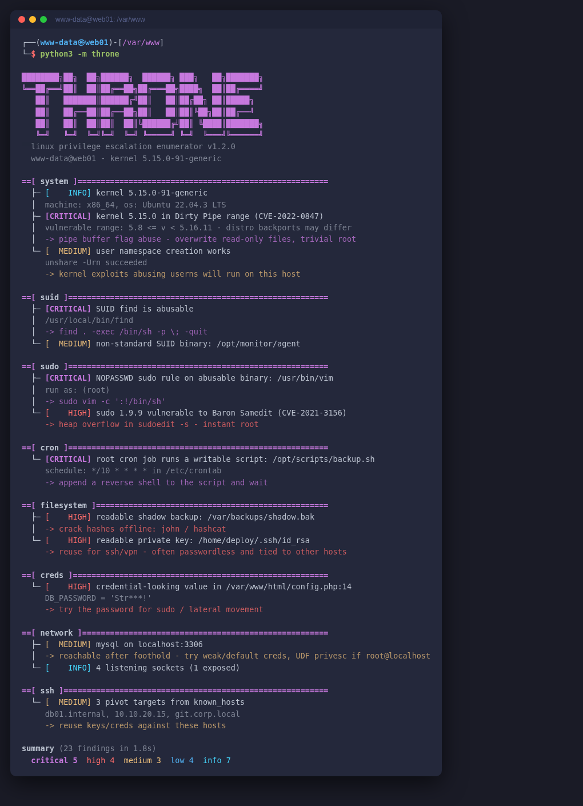

# Throne

[](https://github.com/d3xm0s/Throne/actions/workflows/ci.yml)
[](LICENSE)


*[English](#english) | [Русский](#русский)*



## English

Privilege escalation enumerator for Linux and Windows. The Linux side is
pure Python - zero dependencies, stdlib only. The Windows side is a single
static C++17 binary, WinAPI only. Run it on a compromised host and it maps
every local path from your current user to root, ranked and with exploitation
hints.

### What it checks

| Module | Coverage |
|---|---|
| `system` | kernel matched against 16 known LPE ranges (Dirty COW, Dirty Pipe, nf_tables, GameOver(lay)...), glibc checked for Looney Tunables, container detection, docker.sock, user namespaces, mitigations |
| `suid` | SUID/SGID sweep matched against an embedded GTFOBins database - stock system binaries are filtered out |
| `capabilities` | file capabilities, dangerous caps flagged with their abuse path |
| `sudo` | sudo version CVEs (Baron Samedit, pwfeedback, chroot escape), `sudo -n -l` NOPASSWD rules matched against GTFOBins, PwnKit, readable sudoers |
| `cron` | writable crontabs and cron directories, root jobs running writable scripts |
| `filesystem` | writable /etc/passwd/shadow/sudoers, readable shadow backups, SSH private keys, shell histories with credential keywords |
| `nfs` | no_root_squash exports |
| `services` | root processes running writable binaries, writable systemd units, PATH hijack |
| `creds` | password/token patterns in config files - values redacted in output, comments and placeholders skipped |
| `procs` | credentials in process cmdlines, dangerous capabilities held by non-root processes (user-namespace sandboxes excluded) |
| `network` | listening sockets mapped against exploitable services (redis, docker api, mongodb...) |
| `containers` | docker/lxd/disk group membership, container escape surface |
| `ssh` | sshd config weaknesses, writable authorized_keys, pivot targets from known_hosts |
| logs/creds depth | credential keywords in /var/log, root-owned writable files under /etc, writable root dotfiles |

Every finding carries a severity (`info` / `low` / `medium` / `high` /
`critical`), context, and a concrete exploitation hint.

### Usage

```sh
python3 -m throne                 # full sweep
python3 -m throne --checks sudo,suid,cron
python3 -m throne --min-severity medium
python3 -m throne --lang ru       # russian interface
python3 -m throne --json report.json
python3 -m throne --fail-on high  # exit 1 if anything high+ fires
python3 -m throne --list-checks
```

No installation needed - copy the `throne/` directory to the target and run
it with whatever Python 3.10+ is already there. No network calls, no writes
to disk, no dependencies.

### Windows

The `windows/` directory holds `throne_win.cpp` - the same enumerator for
Windows targets in C++17, WinAPI only, single static binary. Covers token
privileges (potato family detection), services (unquoted paths, writable
binaries, weak DACLs), scheduled tasks as SYSTEM, autoruns, registry
misconfig (AlwaysInstallElevated, UAC, autologon creds, WSUS over HTTP),
stored credentials, browser credential stores with DPAPI hints, wifi passwords,
defense posture (Defender, AMSI, LSA protection, AppLocker), installed software
with credential value (KeePass, WinSCP, FileZilla...), loot files (kdbx, rdp,
sitemanager.xml), PATH hijack, and build-based CVE matching (PrintNightmare,
HiveNightmare with a live ACL check on the SAM hive).

Grab a prebuilt `throne-win.exe` from Releases, or build with mingw-w64:

```sh
make -C windows
```

## Русский

Поиск путей повышения привилегий в Linux и Windows. Linux-версия - чистый
Python, ноль зависимостей, только стандартная библиотека. Windows-версия -
один статический бинарь на C++17, только WinAPI. Запускаешь на
скомпрометированном хосте - и инструмент строит карту всех локальных путей
от текущего пользователя до root/SYSTEM, с ранжированием и подсказками по
эксплуатации.

### Что проверяет

| Модуль | Покрытие |
|---|---|
| `system` | ядро против 16 известных LPE-диапазонов (Dirty COW, Dirty Pipe, nf_tables, GameOver(lay)...), glibc на Looney Tunables, контейнеры, docker.sock, user namespaces, митигации |
| `suid` | SUID/SGID свип со встроенной базой GTFOBins - стоковые бинари отфильтрованы |
| `capabilities` | файловые capabilities, опасные caps с путём абьюза |
| `sudo` | CVE версий sudo (Baron Samedit, pwfeedback, chroot escape), NOPASSWD-правила из `sudo -n -l` через GTFOBins, PwnKit, читаемый sudoers |
| `cron` | доступные на запись crontab'ы и cron-директории, root-задачи на записываемых скриптах |
| `filesystem` | записываемые /etc/passwd/shadow/sudoers, читаемые бэкапы shadow, приватные SSH-ключи, истории шелла с кредами |
| `nfs` | экспорты с no_root_squash |
| `services` | root-процессы на записываемых бинарях, записываемые systemd unit'ы, hijack PATH |
| `creds` | пароли и токены в конфигах - значения маскируются в выводе, комментарии пропускаются |
| `procs` | креды в cmdline процессов, опасные capabilities у не-root процессов (user-namespace песочницы исключены) |
| `network` | listening-сокеты против базы эксплуатируемых сервисов (redis, docker api, mongodb...) |
| `containers` | членство в docker/lxd/disk, поверхность побега из контейнера |
| `ssh` | слабости sshd, записываемые authorized_keys, цели пивотинга из known_hosts |
| глубина кредов | пароли в /var/log, записываемые root-файлы в /etc, dotfiles root |

### Использование

```sh
python3 -m throne                 # полное сканирование
python3 -m throne --checks sudo,suid,cron
python3 -m throne --min-severity medium
python3 -m throne --json report.json
python3 -m throne --fail-on high  # код выхода 1, если есть находки high+
```

Установка не нужна - копируешь каталог `throne/` на цель и запускаешь любым
Python 3.10+, который там уже есть. Без сети, без записи на диск, без
зависимостей.

### Windows

В каталоге `windows/` лежит `throne_win.cpp` - тот же нумератор для
Windows-целей на C++17, только WinAPI, один статический бинарь. Покрывает
привилегии токена (детект potato-семейства), сервисы (unquoted paths,
записываемые бинари, слабые DACL), задачи планировщика от SYSTEM, автозагрузку,
мисконфиги реестра (AlwaysInstallElevated, UAC, пароли автологона, WSUS по
HTTP), сохранённые креды, браузерные хранилища с DPAPI-подсказками, пароли
Wi-Fi, состояние защиты (Defender, AMSI, LSA protection, AppLocker), софт с
кредами (KeePass, WinSCP, FileZilla...), loot-файлы (kdbx, rdp,
sitemanager.xml), hijack PATH и матчинг CVE по номеру билда (PrintNightmare,
HiveNightmare с живой проверкой ACL на SAM).

Готовый `throne-win.exe` - в Releases, сборка через mingw-w64:

```sh
make -C windows
```

## License

MIT
